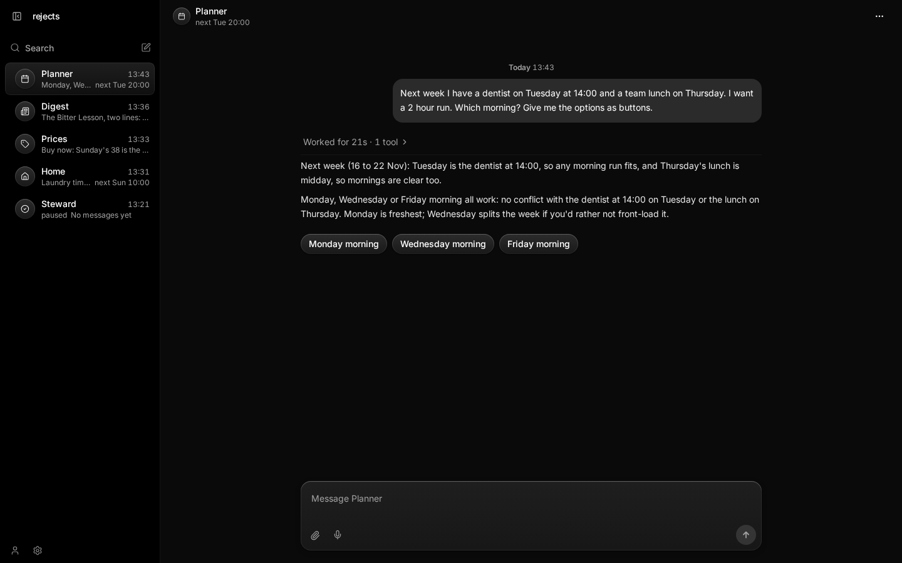
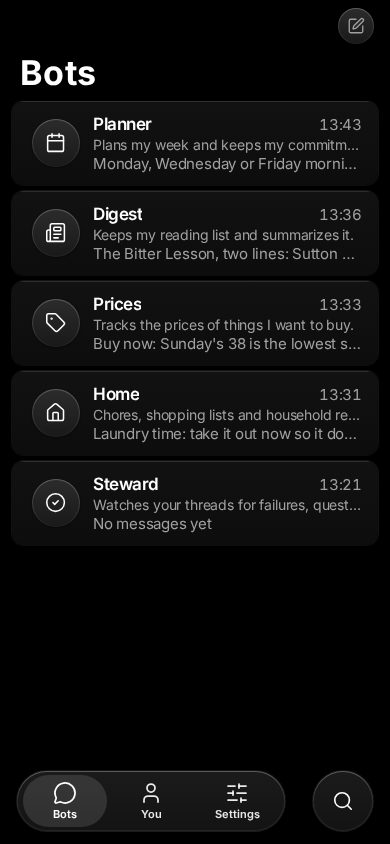
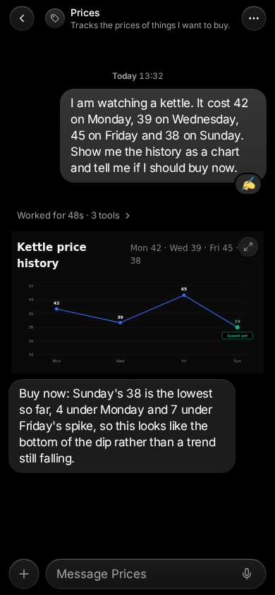
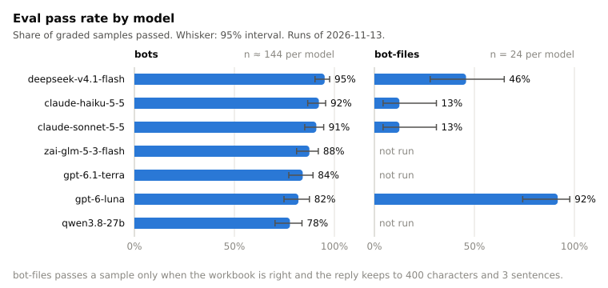
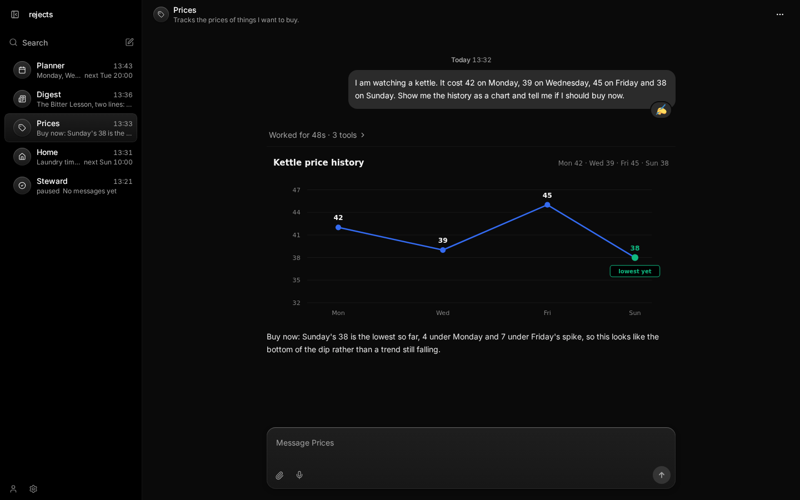
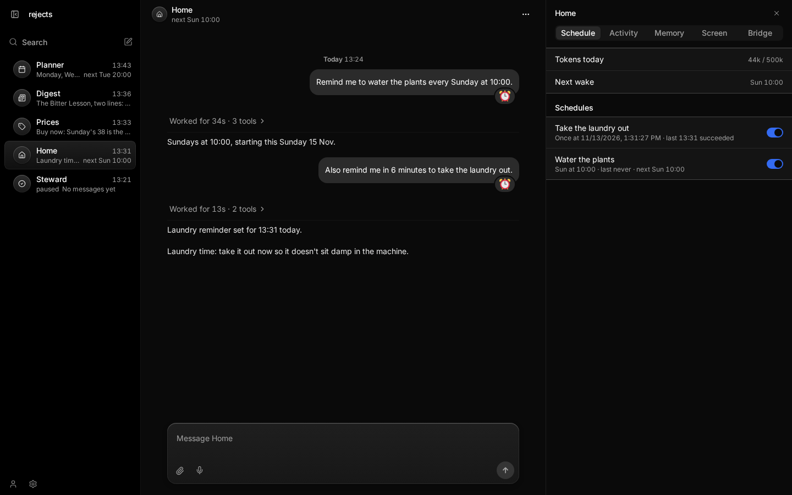
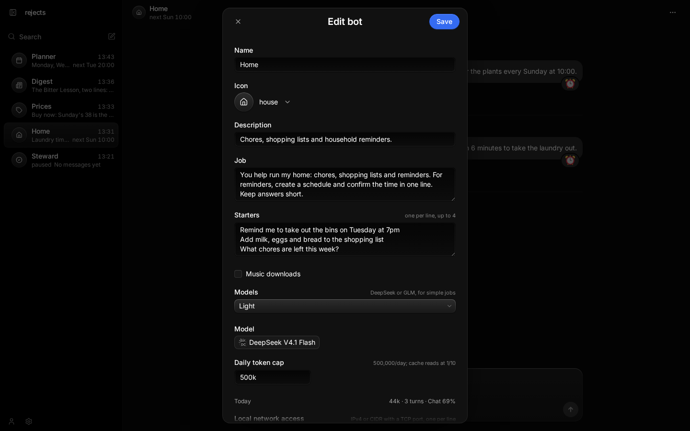
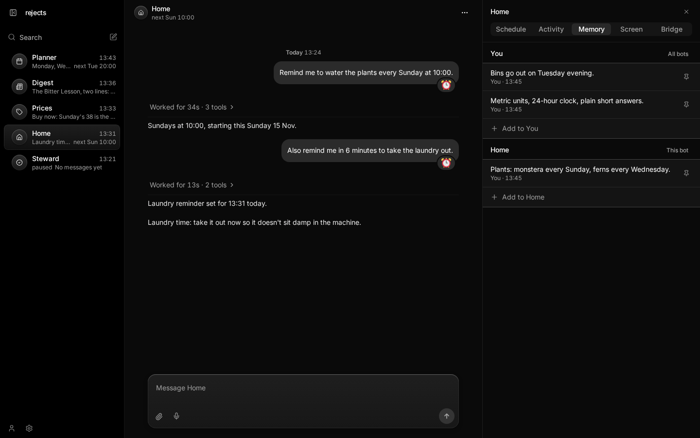

# rejects

A self-hosted bots app built on [T3 Code](https://github.com/pingdotgg/t3code). Each bot is one ongoing chat with a job, its own memory and tools, and a daily token budget; bots wake on schedules, reach you by push and Telegram, browse the web and hand work to each other.



## Security model

Bots read the web, and the web can carry instructions. rejects assumes any bot can be talked into anything and limits what it can reach.

- **Sandboxed shells.** On Linux with `bwrap` and the network rule set up (or `"network": "open"`), every bot run goes through bubblewrap; without the sandbox a bot has no shell of its own, only T3's MCP tools, and runs only on Claude or OpenCode. A sandboxed bot sees the system read-only plus its own workspace and home. Server state, the vault and other bots' files do not exist inside the sandbox. An nftables table limits each bot's network to public addresses and the endpoints you list; per-bot local network grants change only from your settings session, never from a bot or a tool. See [docs/operations/bot-sandbox.md](docs/operations/bot-sandbox.md).
- **A vault the model cannot read.** Passwords, browser profiles and OAuth tokens live in a separate vault process under its own user. You sign in on your phone; the bot then acts as that account without seeing the credential. Every action is in the vault's audit log. See [docs/operations/vault.md](docs/operations/vault.md).
- **Sealed bots.** A bot with account access, a bridge grant or the music tools runs sealed: its provider's own tools are off, and no other bot reads or messages its chat, so what it reads has no way out.
- **Changes by one-tap cards.** A bot proposes; you approve. Runs in a linked environment, `lab_shell` changes and hand-offs to another bot each wait for your tap, and a change runs once, exactly as shown on its card.

## Use it from your phone

The web app adapts to a narrow screen: a list of bots, one chat per bot, and a tab bar for Bots, You and Settings. Web Push and microphone access need HTTPS or a browser-trusted origin.

<p>
  
  
</p>

## Models

<picture>
  <source media="(prefers-color-scheme: dark)" srcset="docs/readme/eval-pass-rates-dark.svg">
  <source media="(prefers-color-scheme: light)" srcset="docs/readme/eval-pass-rates-light.svg">
  
</picture>

Pass rate per model on two evals from the author's private eval set, runs of 2026-11-13. bots is 48 real bot tasks × 3 samples, bot-files is 8 spreadsheet jobs × 3 samples, and whiskers are 95% intervals.
The cases come from real chats, so they stay private and only these totals are published.

## Bots

A bot is a persona, a model, a daily token cap and a set of tools. Its conversation never resets: when the context fills, older turns are compacted into a recap and the chat continues. Create bots in the app, or ask the main bot to set them up. The main bot is the front door in the web app and in Telegram; it routes requests and connects accounts.

A bot's model comes from a template. `light` uses one cheap model, `opus` uses Opus alone, and `lead` has Opus talk to you and hand real work to a cheaper worker as a strict task, then check the result. A bot can also use a model you pick by hand from any configured provider.

Replies can end with up to four buttons for short answers. A tap sends that text as your message. Bots react to messages with emoji, share files and render HTML for charts when an answer compares numbers or shows a trend. A chart page loads nothing from outside.



## Schedules and notifications

Bots create their own schedules, at least five minutes apart, in your time zone. A schedule wakes the bot in its own session. The wake reaches you only when the bot calls `notify_user` or sends to Telegram, and a wake with nothing to report stays out of the chat.

Notifications are Web Push to every device that turned them on. Push is skipped for the conversation you have open. Scheduled tasks are listed in Settings.



## Telegram

The main bot's chat is also a Telegram chat. In the Telegram section of Connections, add a bot token from BotFather and claim the bot with the one-time code sent as `/start <code>`. Messages and voice notes land in the same thread as web messages, replies go back, and unread results from other bots reach Telegram after a delay. Bots send text, files and charts rendered as PNG photos.

## Budgets and usage

Every bot has a daily token cap, 20M by default, that counts delegated workers too. At the cap the bot stops until the next day. A bot's settings list its tokens by source: chat, workers, dreaming and keep-warm. The Usage page shows token use and estimated API-equivalent cost across the coding providers on the server.



## Memory and skills

Bots keep short notes. A bot writes a note when you state a preference, correct it or react to a result, and only from your own words. Pages, files and tool results never become notes. Notes a bot keeps for its job stay with that bot. Notes about you, such as your language, units and names, are shared by all bots. Search is hybrid keyword and embedding search; the embedder is optional.

Every night at 03:30 server time a check reviews each bot's notes and proposes cleanups, and reviews recent chat runs to propose skills for work you asked for more than once. Skills are saved as the bot's own skills, and a change from the check can be undone from settings. Built-in skills cover bot setup and administration, skill creation, YouTube links, OLX search and music downloads.



## Cortex

Cortex is a local knowledge store for transcripts and notes. It runs as its own MCP server in `apps/cortex` with read and write tokens, keeps sources as Markdown and events as JSONL, and searches with SQLite full-text and vector indexes. It has typed observations for belief, exposure and understanding, with supersession links. Bots reach it through `cortex-mcp.json` in the state directory. Any MCP client can use the same endpoint. See [apps/cortex/README.md](apps/cortex/README.md).

## Computer and web

A bot with computer tools has a desktop, a browser with DOM and accessibility refs, and a shell in its own work directory. With the sandbox on, each bot gets its own computer on the server. With the sandbox off, bots use one separate machine set in `bot-computer.json`. Recordings of what bots do on the computer and in accounts keep one log line per action and a screenshot after each browser action, with secrets redacted, and expire after a retention period.

`web_search` and `web_browse` use a Camoufox browser through `camofox.json` in the state directory. When a page stops the browser at a Cloudflare or Turnstile check, `web_browse` can read it through a trawl scraper set as `trawlUrl` in the same file. A bot never solves a bot check itself. When a page needs you, it sends you the check to pass.

Accounts are connected by you, on your phone. The bot asks for a login, you sign in, and the bot then acts as that account without seeing the password. Credentials, browser profiles and OAuth tokens live in a separate vault process. See [docs/operations/vault.md](docs/operations/vault.md).

## Bots working together

A bot does its own job and names the bot that does the rest. `hand_off` shows a button under the reply that opens the other bot's chat with a draft in the composer. Nothing reaches that bot until you send it. The main bot hands another bot work the way any T3 thread does: `give_files` for your files, then `t3_thread_send`, `t3_thread_wait` and `t3_thread_read`, and it answers you with that bot's reply and a link to its chat. Main reaches only bots that are not sealed (no account, bridge or music access). `delegate_task` runs a worker in its own thread and counts toward the bot's cap.

## Music

An optional integration with your own [slskd](https://github.com/slskd/slskd) (Soulseek) daemon: a music bot searches, downloads and imports albums into a library over SSH. It is off until `music.json` exists in the state directory; the slskd API key stays in the server's secret store.

## Threads

Threads is the coding side, inherited from T3 Code: agent sessions for Codex, Claude Code, Cursor, Grok, OpenCode and Antigravity, with checkpoints, diffs, terminals, pull request tools and worktrees. Bots can propose runs in a linked environment. A run starts only when you approve it in the app.

## Install

You need [Vite+](https://viteplus.dev/guide/) (`vp`), which provides the Node version pinned in [package.json](package.json), and an installed, authenticated agent provider. Bots on Linux also need `bubblewrap`.

```sh
git clone https://github.com/lbgos/rejects.git
cd rejects
vp i
vp run dev
```

Open the pairing URL printed by the dev runner. The bare origin does not authenticate a new browser. Development state lives in the worktree's `.t3` directory.

The dev runner registers a `Replay (dev)` provider that replays recorded turns for free. The first run in Bots picks the model for your bots from the providers this machine has. Without the bot sandbox (Linux with `bubblewrap` and its network rule, or `"network": "open"`), bots run with no shell of their own, on Claude or OpenCode. `node apps/server/dist/bin.mjs doctor` shows what works on this machine.

For a built server:

```sh
vp run --filter t3 build
vp run start
```

The server listens on `127.0.0.1:3773` and opens the web app. `serve` starts it without opening a browser.

Once a release is published on [GitHub Releases](https://github.com/lbgos/rejects/releases), `npx @lbgos/rejects` downloads that release's server for this machine (macOS on Apple silicon, Linux or Windows, x64 or arm64) and starts it, with no checkout. Cortex is not part of that package; it needs a checkout as above.

### Data and remote browsers

Installed server data defaults to `~/.rejects`. Conversations and SQLite state live in `~/.rejects/userdata`, next to `bots.json`, bot workspaces, secrets and the optional `camofox.json`, `cortex-mcp.json` and `bot-sandbox.json`. `--base-dir` or `T3CODE_HOME` selects another directory. Back up the data directory to keep your bots and chats.

A loopback-bound server signs in local browsers automatically. To use a phone or another browser, bind the server to a reachable interface and mint a one-time pairing link:

```sh
node apps/server/dist/bin.mjs serve --host 0.0.0.0
node apps/server/dist/bin.mjs pair
```

Open the pairing link in the remote browser and keep it private. Use HTTPS for access across the internet; Web Push and microphone access need a secure origin. Docs for access, devices and providers are in [docs](docs/README.md).

Example settings files and a systemd unit are in [docs/examples](docs/examples).

## Linux only

Chat bots, memory, schedules, Telegram, push and peer links run wherever the server runs. These need Linux:

- the bot sandbox and shell (bubblewrap, nftables, a delegated cgroup);
- account browsers (the vault user, Chrome, the egress rules);
- `lab_shell` (`lab.json`);
- `video_transcript`'s sandboxed downloader.

## Credits

A fork of [T3 Code](https://github.com/pingdotgg/t3code) by T3 Tools Inc., not affiliated with or endorsed by T3 Tools Inc. Made by [lbgos](https://github.com/lbgos).

Contact: [contact@lbgos.dev](mailto:contact@lbgos.dev). Security reports: see [SECURITY.md](.github/SECURITY.md).

## License

MIT, Copyright (c) 2026 T3 Tools Inc. and Copyright (c) 2026 lbgos. See [LICENSE](LICENSE). Notices for bundled third-party packages are in [third-party-licenses](third-party-licenses).
